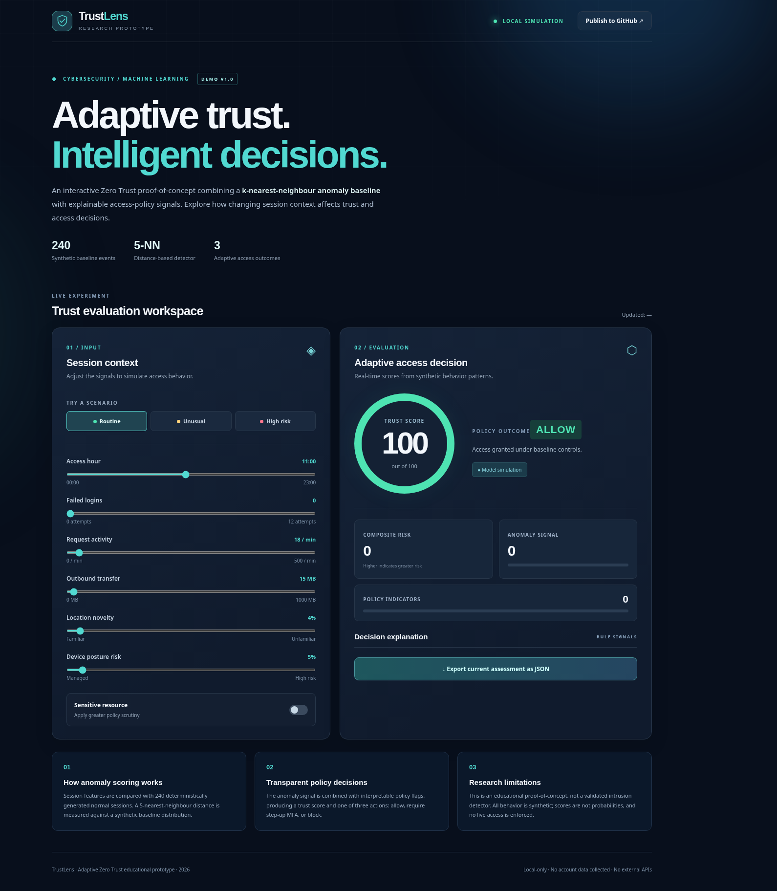

# TrustLens — Adaptive Zero Trust Research Prototype

**Interactive proof-of-concept · Cybersecurity / Machine Learning · 2026**

TrustLens demonstrates how a **distance-based anomaly detector** can be combined with **interpretable policy signals** to support adaptive access decisions in a Zero Trust environment. It is inspired by the academic topic *Machine Learning Approaches for Dynamic Trust Assessment in Zero Trust Architectures*.

> **Scope:** An independent educational implementation of a simulated risk engine. It is **not** a deployed Zero Trust product, published research, peer-reviewed validation, production-ready intrusion detection system, or evidence of real-world detection performance. All modeled events are synthetic and the numeric outputs are illustrative, not calibrated probabilities.

## Preview



## Features

- Interactive controls for six session features and a sensitivity flag.
- Three preconfigured scenarios: routine, unusual, and high-risk access.
- **5-nearest-neighbour (5-NN)** anomaly scoring against 240 seeded synthetic normal events.
- Interpretable rule-based policy signals for login failures, device posture, location novelty, traffic volume, unusual time, and resource sensitivity.
- Adaptive actions: **ALLOW**, **STEP-UP MFA**, and **BLOCK** (simulated; no real enforcement).
- Export the current assessment as JSON.
- Zero backend, credentials, or API keys; static files compatible with GitHub Pages.
- Deterministic automated tests using the Node.js built-in test runner.

## Quick start

**Option A — GitHub Pages:** Upload the repository and enable Pages using **Deploy from a branch → main → / (root)**. No build step is needed.

**Option B — local browser:** From this directory, run:

```bash
python -m http.server 8000
```

Then open <http://localhost:8000>.

Running via a local server is recommended because the dashboard uses JavaScript ES modules.

## Tests

```bash
npm test
```

Requires Node.js 18+; no `npm install` step or third-party packages are needed.

## Methodology summary

1. Generate **240 synthetic baseline events** with a fixed random seed.
2. Normalize a small set of numeric session features, then compute weighted Euclidean distances.
3. For each input event, compute its average distance to the five nearest baseline examples.
4. Compare that distance against the 75th–99th percentile range of leave-one-out baseline distances to derive an illustrative anomaly score.
5. Combine `64% anomaly score + 36% policy-indicator score` into an illustrative composite risk; trust is `100 - risk`.
6. Assign `ALLOW` for trust ≥ 75, `STEP-UP` for 45 ≤ trust < 75, and `BLOCK` for trust < 45.

**This combination and its thresholds are demonstration choices, not empirically validated weights.** This is a simple instance-based anomaly detector, not a neural network or a trained deep learning model.

See [the technical methodology and limitations](docs/METHODOLOGY.md) for more detail.

## Project structure

```text
adaptive-zero-trust-demo/
├── index.html            # Interactive dashboard
├── assets/styles.css     # Responsive UI styles
├── src/engine.js         # KNN reference model and risk calculation
├── src/main.js           # UI interactions and JSON export
├── tests/engine.test.mjs # Functional checks
├── docs/METHODOLOGY.md   # Assumptions and limitations
└── docs/screenshot.png   # Dashboard preview
```

## Academic use and attribution

This repo is a **small demonstration prototype**, not the group Seminar paper itself. If submitting it as a project achievement, disclose its creation date, educational scope, and your actual role in reviewing, testing, adapting, and presenting the work. Do not label it as published, as production security software, or as an experimentally validated detector.

## Русское описание

**TrustLens** — учебный прототип адаптивной оценки доверия в архитектуре Zero Trust. Приложение объединяет простой алгоритм обнаружения аномалий на основе метода k ближайших соседей и объяснимые правила контроля доступа. Используются только синтетические данные. Результаты носят демонстрационный характер и не предназначены для эксплуатации в реальной системе информационной безопасности.

## License

MIT — see [LICENSE](LICENSE).
